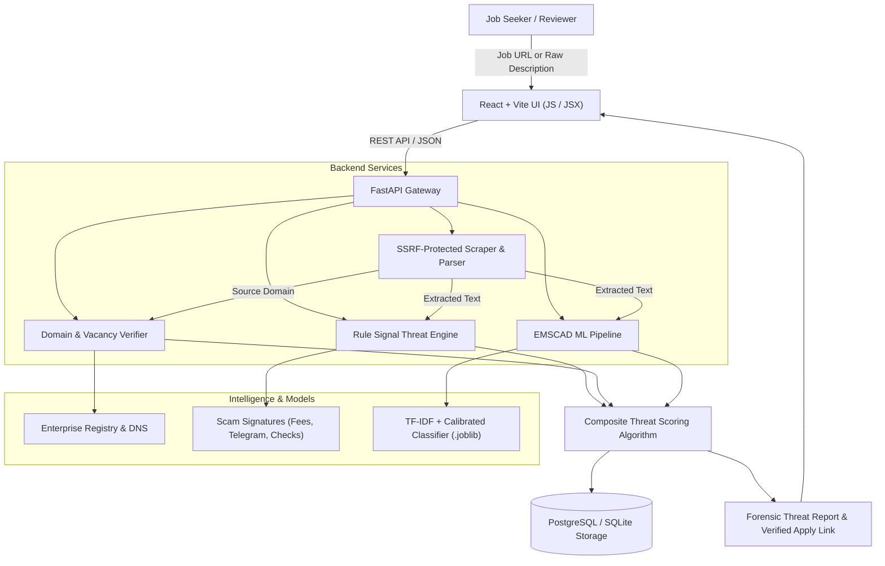

# Fake Job Detection & Verification Platform - System Architecture

## 1. System Overview

The **Fake Job Detection & Verification Platform** is an enterprise-grade defense intelligence platform engineered to protect job seekers from recruitment scams, advance fee fraud, identity harvesting, counterfeit check laundering, and employer impersonation.

The system combines:
1. **Supervised Machine Learning**: Trained on the Employment Scam Aegean Dataset (EMSCAD).
2. **Deterministic Heuristic Risk Engine**: High-precision regex pattern recognition targeting upfront payment demands, untraceable chat apps (Telegram, Signal, WhatsApp), and unrealistic compensation formulas.
3. **Domain & Vacancy Corroboration Engine**: Authoritative DNS resolution, enterprise domain verification, and Applicant Tracking System (ATS) corroboration.
4. **Persistent Audit History**: Production-ready PostgreSQL / SQLite storage with SQLAlchemy ORM.

---

## 2. Component Architecture

### 2.1 Frontend (React + Vite)
- **Runtime**: Pure JavaScript & JSX (no TypeScript).
- **Styling**: Modern dark/light cyber-defense design system with custom CSS variables.
- **Pages**:
  - `LandingPage`: Product presentation, one-click test presets, and hero scanner.
  - `DashboardPage`: Real-time telemetry, threat metrics, and recent scans.
  - `AnalyzePage`: Dual-mode submission (URL auto-fetch vs manual text), live extraction.
  - `AnalysisDetailPage`: Radial SVG risk gauge (0–100), detected signals with evidence quotes, ML diagnostic breakdown, and official verified application link.
  - `JobSearchPage`: Search verified corporate openings vs cataloged scam patterns.
  - `HistoryPage`: Database audit logs with search, filtering, and inspection.
  - `AboutPage`: Scientific documentation, EMSCAD dataset specs, and security controls.

### 2.2 Backend (FastAPI + Python 3)
- **FastAPI Core**: Modular routers with Pydantic request validation and security response headers (`X-Content-Type-Options`, `X-Frame-Options`, `X-XSS-Protection`).
- **Database Abstraction**: SQLAlchemy ORM with automatic SQLite/PostgreSQL failover.
- **Machine Learning**:
  - `dataset_loader.py`: Handles EMSCAD ingestion, cleaning, and seed fallback generation.
  - `pipeline.py`: Combines job fields into unified text, applies `TfidfVectorizer`, and classifies using `LogisticRegression(class_weight='balanced')`.
  - `train.py`: Strict stratified train/test split preventing data leakage.
  - `evaluate.py`: Generates precision, recall, F1, ROC-AUC, and confusion matrix.
- **Safety & SSRF Protection**:
  - Disallows loopback (`127.0.0.0/8`), private networks (`10.0.0.0/8`, `172.16.0.0/12`, `192.168.0.0/16`), and cloud metadata (`169.254.169.254`).
  - Limits execution to 8-second timeouts and 2 MB content caps.

---

## 3. Threat Classification Matrix

| Composite Risk Score | Classification | Action Taken |
|---|---|---|
| **0.0 – 34.9** | **SAFE** | Standard corporate patterns observed. Verified official application link enabled when vacancy is corroborated. |
| **35.0 – 64.9** | **SUSPICIOUS** | Anomaly or domain uncertainty detected. Caution advisory issued; link directed only to general careers portal. |
| **65.0 – 100.0** | **HIGH_RISK** | Active scam signatures (fees, wire fraud, telegram interview, or domain impersonation) detected. Application link blocked. |
